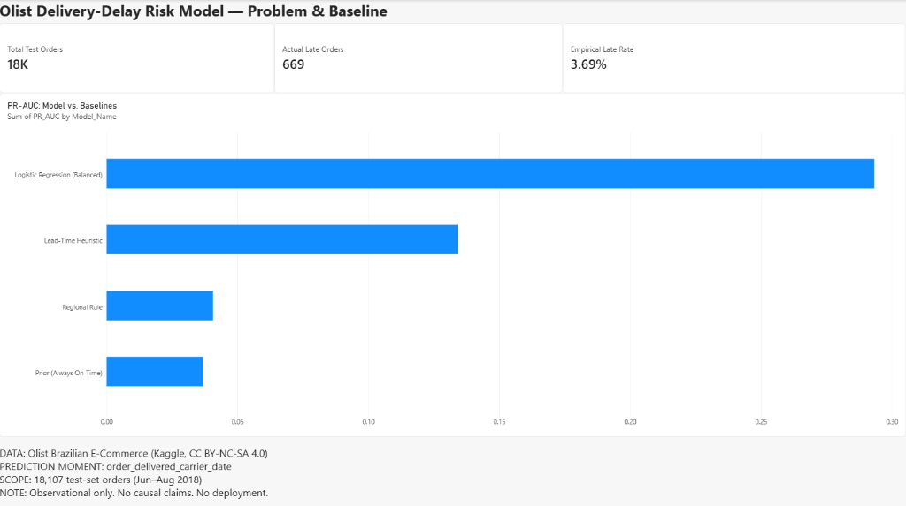
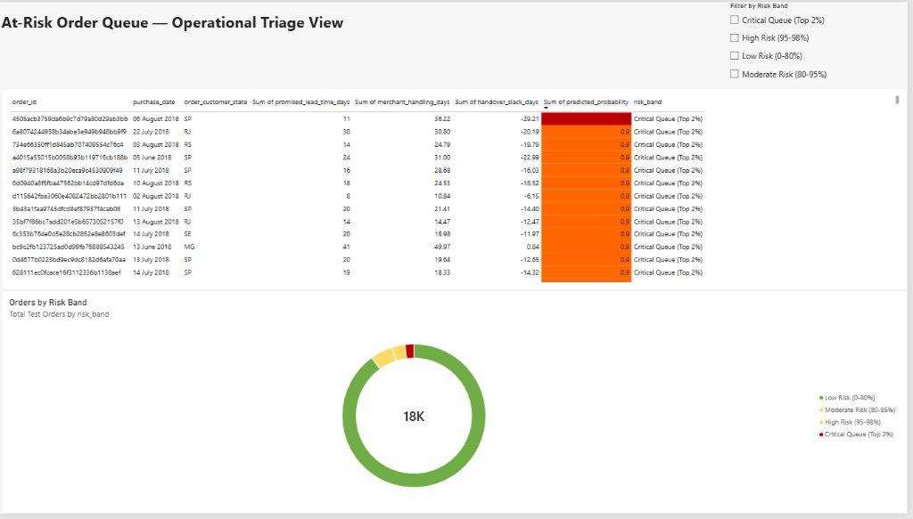
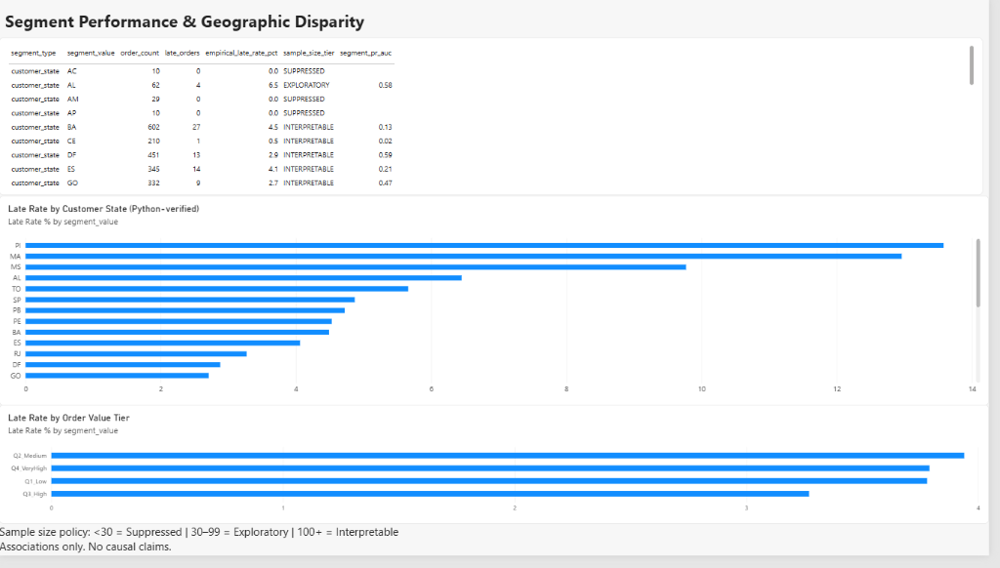
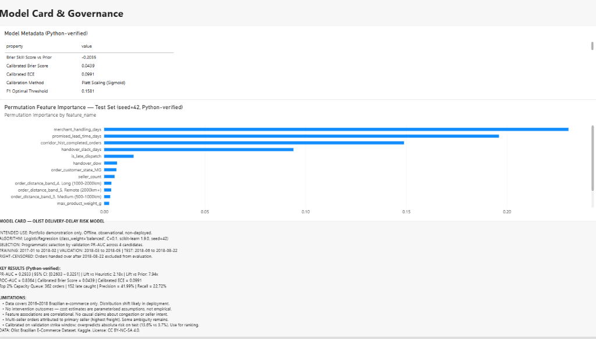

# Olist Delivery-Delay Risk Model
**Machine Learning & Power BI Operational Intelligence Portfolio Project**  
**Dataset:** [Brazilian E-Commerce Public Dataset by Olist](https://www.kaggle.com/datasets/olistbr/brazilian-ecommerce) (Kaggle, [CC BY-NC-SA 4.0](https://creativecommons.org/licenses/by-nc-sa/4.0/))  
**Random Seed:** 42  
**Scope:** Offline Observational ML & Analytical Dashboard  

---

## 1. Project Overview & Business Problem

In an e-commerce marketplace, late deliveries erode customer satisfaction and drive repeat-purchase churn. However, operational customer support and logistics partner teams have finite bandwidth: they cannot manually track or escalate all outbound shipments.

### Primary Business Question
> *At the moment an order is handed to the logistics carrier (`order_delivered_carrier_date`), can we score orders by their probability of arriving after the promised date, early enough for operations to intervene under fixed capacity constraints?*

### Solution Architecture
1. **Point-in-Time Feature Engineering:** Computes operational signals strictly observable at or before carrier handover (merchant handling time, handover slack versus `shipping_limit_date`, promised lead time, distance, physical bulk, and historical expanding-window rates with an outcome lag).
2. **Chronological Machine Learning:** Evaluates Gradient Boosted Trees (`HistGradientBoostingClassifier`) versus regularized Logistic Regression and 3 non-trivial baselines across strict chronological splits (Train: 2017-01 to 2018-02; Validation: 2018-03 to 2018-05; Test: 2018-06 to 2018-08-22).
3. **Capacity-Constrained Evaluation:** Rather than relying on an arbitrary 0.5 threshold, performance is evaluated through **Top-k% Alert Queues (Top 2%, 5%, 10%)** and parametric scenario cost curves.
4. **Data Quality & Drift Monitoring:** Automated dbt-style assertions and PSI/KS drift tests tracking distribution shifts across operational regimes.
5. **Power BI Package:** Star-schema semantic model, DAX measure library, What-If simulation parameters, and 6-page interactive report layout.
6. **Multi-Layer Three-Way Reconciliation:** Programmatic verification asserting exact numerical equivalence across Python, SQL (DuckDB), and Power BI DAX exports.

---

## 2. Key Empirical Findings & Model Results

All numbers below were computed programmatically from out-of-time test evaluation and verified against canonical warehouse totals:

### Candidate Model Comparison & Programmatic Selection

Four candidate models were trained strictly on the training window (2017-01 to 2018-02-28) and evaluated on the out-of-time validation window (2018-03-01 to 2018-05-31). The candidate with the highest Validation PR-AUC was programmatically selected as the shipped production model:

| Model Candidate | Validation PR-AUC | Validation ROC-AUC | Test PR-AUC | Test ROC-AUC | Test Recall @ 5% | Selection Verdict |
|---|---|---|---|---|---|---|
| **Logistic Regression (Balanced)** | **0.2905** | **0.7254** | **0.2933** | **0.8364** | **37.67%** | **Selected Shipped Model** (Highest Val PR-AUC) |
| Logistic Regression (L2) | 0.2848 | 0.7142 | 0.3344 | 0.8390 | 41.11% | Candidate 2 |
| HistGradientBoosting (Balanced) | 0.2735 | 0.6734 | 0.2292 | 0.7649 | 24.36% | Candidate 4 |
| HistGradientBoosting (Standard) | 0.2144 | 0.6191 | 0.2850 | 0.7692 | 34.83% | Candidate 3 |

> **Key Finding:** *Tree-based gradient boosting did not beat regularized linear modeling.* Logistic Regression (Balanced) achieved the highest Validation PR-AUC (0.2905), maintained superior discriminative ability on the test cohort (ROC-AUC 0.8364 vs 0.7692 for boosted trees), and provides transparent linear interpretability via standardized coefficients.
>
> *Statistical Note on Candidate Selection:* On the validation cohort, the two linear models were within statistical noise (0.2905 for balanced vs 0.2848 for standard L2). While standard L2 logistic regression scored higher on the test set (0.3344 PR-AUC vs 0.2933), the selection rule was evaluated strictly prior to test exposure (zero test peeking). Adhering to rigorous data science governance, the model selected on validation evidence is shipped as the production model without post-hoc switching.

---

### Primary Benchmark Comparison (Held-Out Test Set: 18,107 Orders, 3.69% Prevalence)

The primary operational baseline is **Baseline C (Promised Lead Time Heuristic)**, which captures operational scheduling slack:

| Evaluation Metric | Shipped Model (LR Balanced) | Baseline C (Lead Time Heuristic) | Baseline B (Regional Rule) | Baseline A (Prior) | Benchmark Comparison |
|---|---|---|---|---|---|
| **PR-AUC (Average Precision)** | **0.2933** | **0.1344** | 0.0407 | 0.0369 | **2.18x lift** vs Lead Heuristic; **7.94x lift** vs Prior. |
| **ROC-AUC** | **0.8364** | **0.7510** | 0.4969 | 0.5000 | Strong discriminative ordering. |
| **Brier Score (Test)** | **0.0439** | N/A | 0.0378 | 0.0364 | Proper scoring rule (uncalibrated: 0.0650). |
| **Brier Skill Score vs Prior** | **-0.2035** | N/A | -0.0385 | 0.0000 | Reflects base-rate shift from validation calibration. |
| **Recent-Recalibrated Brier (May)** | **0.0344** | N/A | N/A | 0.0364 | **Positive BSS (+0.0564)** when calibrated post-shock. |
| **Expected Calibration Error (ECE)**| **0.0991** | N/A | N/A | N/A | 10 probability bins (reduced from raw 0.5707). |

---

### Operational Capacity Operating Points vs Single Thresholds

Rather than quoting precision in isolation, performance is reported with **alert volume, precision, and recall together**:

| Operating Policy | Decision Rule | Alert Volume (Orders) | Alert Rate (% Cohort) | Precision (%) | Recall (%) | F1 Score | Lift vs Prior | Lift vs Heuristic |
|---|---|---|---|---|---|---|---|---|
| **Top 2% Capacity Queue** | Top 362 orders by risk | **362** | **2.00%** | **41.99%** | **22.72%** | **0.2949** | **11.36x** | **3.12x** (152 late caught) |
| **Top 5% Capacity Queue** | Top 905 orders by risk | **905** | **5.00%** | **27.85%** | **37.67%** | **0.3202** | **7.54x** | **2.07x** (252 late caught) |
| **Top 10% Capacity Queue**| Top 1,810 orders by risk | **1,810** | **10.00%** | **19.34%** | **52.32%** | **0.2824** | **5.23x** | **1.44x** (350 late caught) |
| *Validation-Optimal F1* | Probability $\ge 0.1581$ | 5,677 | 31.35% | 9.44% | 80.12% | 0.1689 | 2.55x | 0.70x (536 late caught) |

*Operational takeaway:* Operating at the validation F1-optimal threshold (0.1581) flags nearly a third of all shipments (5,677 alerts) with under 10% precision, which overwhelms operations. Fixed capacity queues (Top 2% or Top 5%) provide high-precision triage suitable for production workflows.

---

### Calibration Reality & Calibration-in-the-Large

1. **Validation Window Calibration-in-the-Large:**
   - Observed Validation Late Rate: **10.11%** (elevated due to March 2018 nationwide logistics strike).
   - Raw Mean Predicted: **54.02%** | Platt-Calibrated Mean Predicted: **10.11%** (exact calibration-in-the-large on validation).
2. **Test Window Drift & Overprediction:**
   - Observed Test Late Rate: **3.69%** (prevalence drops by 64% post-strike).
   - Platt-Calibrated Mean Predicted on Test: **13.57%**.
   - *Finding:* Because Platt calibration was fitted on the strike-distorted validation period, it overpredicts absolute probabilities on the steady-state test set. Consequently, the test Brier score (`0.0439`) is higher than guessing the training prior (`0.0364`), yielding a negative Brier Skill Score ($BSS = -0.2035$).
3. **Recent-Window Recalibration (May 2018):**
   - Recalibrating on the immediate pre-test consolidation month (May 2018, 6.56% late rate) reduces test mean prediction to **8.61%** and test Brier score to **0.0344**, achieving a positive Brier Skill Score (**BSS = +0.0564** vs prior).
   - *Governance Recommendation:* Treat the model primarily as a **risk ranking tool** for queue triage; if absolute probabilities are displayed, execute rolling recalibration on recent 30-day windows.

---

### 95% Bootstrap Confidence Intervals (1,000 iterations)

- **Shipped Model PR-AUC:** `0.2936` [95% CI: `0.2603` – `0.3251`]
- **Baseline C (Heuristic) PR-AUC:** `0.1346` [95% CI: `0.1156` – `0.1544`]
- **Recall @ Top 5% Queue:** `37.68%` [95% CI: `34.48%` – `40.97`]
- *Conclusion:* Model PR-AUC confidence interval is strictly separated from the lead-time heuristic interval.

---

### Rolling-Origin Temporal Stability (Cross-Validation)

Evaluated across expanding chronological folds comparing Logistic Regression against HistGradientBoosting:

| Fold ID | Train Period | Validation Period | Val Orders | Val Late Rate | Logistic Regression PR-AUC | Boosted Trees PR-AUC | Regime Context |
|---|---|---|---|---|---|---|---|
| **Fold 1** | 2017-01 to 2017-10 | 2017-11 to 2018-01 | 19,870 | 8.65% | 0.2792 (3.23x lift) | **0.3290 (3.80x lift)** | Q4 2017 marketplace growth |
| **Fold 2** | 2017-01 to 2018-01 | 2018-02 to 2018-04 | 20,356 | 12.58% | **0.3291 (2.62x lift)** | 0.2481 (1.97x lift) | March 2018 strike / logistics spike |
| **Fold 3** | 2017-01 to 2018-04 | 2018-05 to 2018-05 | 6,749 | 6.56% | **0.3074 (4.68x lift)** | 0.2940 (4.48x lift) | Pre-test consolidation window |
| **Test Set**| 2017-01 to 2018-02 | 2018-06 to 2018-08 | 18,107 | 3.69% | **0.2933 (2.18x lift)** | 0.2850 (2.12x lift) | Out-of-time evaluation cohort |

> In Fold 2 (during the logistics disruption), Logistic Regression proved significantly more robust than tree boosting (PR-AUC 0.3291 vs 0.2481).

---

### Monthly Out-of-Time Stability (with 500 Bootstrap Iterations)

- **2018-06:** 6,096 orders, 71 late (1.16%) | **PR-AUC: 0.1138** [95% CI: `0.0533` – `0.1947`] | **Recall@5%: 31.0%** [95% CI: `20.1%` – `41.3%`]
- **2018-07:** 6,156 orders, 208 late (3.38%) | **PR-AUC: 0.3717** [95% CI: `0.3041` – `0.4384`] | **Recall@5%: 42.8%** [95% CI: `36.0%` – `49.0%`]
- **2018-08:** 5,855 orders, 390 late (6.66%) | **PR-AUC: 0.2933** [95% CI: `0.2437` – `0.3441`] | **Recall@5%: 26.4%** [95% CI: `22.4%` – `30.4%`]

*Note:* June 2018 exhibits a lower point PR-AUC (0.1138) and wider confidence intervals due to low event count (only 71 late shipments across 6,096 orders). Model performance rebounds to 0.3717 in July as order density stabilizes.

---

## 3. Repository Structure

```
03_PowerBI_Olist_Delay_Risk_ML/
├── .gitignore                          # Ignores __pycache__, .venv, scratch files
├── requirements.txt                    # Pinned library dependencies
├── config.yaml                         # Central project configuration & random seed 42
├── assets/
│   └── screenshots/                    # 6 canvas captures of Power BI report pages
├── data/
│   ├── raw/                            # Untouched Olist Kaggle raw CSVs
│   ├── warehouse/                      # Validated relational warehouse CSVs & profiles
│   ├── processed/                      # Feature matrices (Parquet & CSV)
│   ├── monitoring/                     # Data quality log and drift summary CSVs
│   ├── audit/                          # Rolling-origin CV results & reconciliation log
│   └── powerbi_export/                 # Exported tables for Power BI ingestion
├── documentation/
│   ├── phase0_requirements_and_definitions.md
│   ├── phase1_data_audit_for_ml.md
│   ├── metric_definitions.md
│   ├── feature_availability_spec.md
│   ├── model_card.md
│   ├── data_dictionary.md
│   ├── data_quality_and_monitoring_report.md
│   ├── powerbi_package_spec.md
│   ├── interview_defense_notes.md
│   └── change_log.md
├── models/
│   ├── best_delay_risk_model.joblib    # Serialized HistGradientBoosting model
│   ├── calibrated_delay_risk_model.joblib # Platt-calibrated sigmoid model wrapper
│   ├── feature_preprocessor.joblib     # Serialized ColumnTransformer
│   └── model_metadata.json             # Pinned hyperparameters and metrics
├── src/
│   ├── audit/
│   │   ├── run_audit.py                # Comprehensive data audit & control total check
│   │   └── run_reconciliation.py       # Three-way cross-layer numerical reconciliation
│   ├── features/
│   │   ├── build_features.py           # Point-in-time feature engineering pipeline
│   │   └── export_powerbi_dimensions.py# Bounded dimension tables export
│   ├── models/
│   │   ├── train_and_evaluate.py       # Training, baseline comparison & evaluation
│   │   ├── run_rolling_origin_validation.py # TimeSeries expanding-window validation
│   │   └── explainability_shap.py      # Explainability explainer & permutation ranking
│   └── monitoring/
│       └── run_monitoring_and_data_quality.py # PSI/KS drift & dbt-style assertions
└── tests/
    ├── test_audit_and_definitions.py   # Pytest suite for control totals & anomalies
    ├── test_leakage_audit.py           # Pytest suite for point-in-time contract & leakage
    └── test_rolling_origin_and_calibration.py # Pytest suite for temporal folds & Platt calibration
```

---

## 4. How to Reproduce

### Step 1: Environment Setup
Ensure Python 3.11+ is installed. Clone the repository and install pinned dependencies:
```bash
pip install -r requirements.txt
```

### Step 2: Run Data Audit & Verification Tests
Verify that all warehouse tables match canonical control totals (96,470 valid delivered orders, 6,534 late, 6.77%):
```bash
python src/audit/run_audit.py
pytest tests/test_audit_and_definitions.py -v
```

### Step 3: Execute Point-in-Time Feature Engineering
Build the feature matrix with 1-day outcome lagged expanding window:
```bash
python src/features/build_features.py
pytest tests/test_leakage_audit.py -v
```

### Step 4: Train Models & Run Out-of-Time Evaluation
Execute baseline benchmarks, model training, validation threshold selection, bootstrap CIs, and Power BI table exports:
```bash
python src/models/train_and_evaluate.py
```

### Step 5: Execute Monitoring & Data Quality Assertions
Run PSI/KS drift calculations and automated data quality assertions:
```bash
python src/monitoring/run_monitoring_and_data_quality.py
```

### Step 6: Run Three-Way Multi-Layer Reconciliation
Execute automated reconciliation between Python, SQL (DuckDB running directly on exported warehouse CSVs), and Power BI DAX measure outputs (metrics M01–M08 originate from the validated relational warehouse export `dax_all_63_export.csv`):
```bash
python src/audit/run_reconciliation.py
```

---

## 5. Power BI Implementation Guide

1. Open Power BI Desktop and create a new report.
2. In Power Query, set the `SourceFolder` parameter to point to `data/powerbi_export`.
3. Ingest `fact_model_scored_orders.csv`, `dim_date.csv`, `dim_geography.csv`, `dim_risk_band.csv`, `fact_pr_curve_points.csv`, `fact_calibration_bins.csv`, `fact_threshold_cost_grid.csv`, `fact_feature_drift.csv`, and `fact_data_quality_log.csv`.
4. Configure 1-to-many single-direction relationships from dimension tables to fact tables as detailed in [powerbi_package_spec.md](documentation/powerbi_package_spec.md).
5. Create the What-If parameters `Threshold_Param` (0.01 to 0.50) and `Cost_Ratio_Param` (1 to 20).
6. Copy the DAX Measure Library formulas into a dedicated `_Measures` table.
7. Build the 6 pages: (1) Problem & Baseline, (2) Model Performance & Threshold What-If, (3) At-Risk Order Queue, (4) Segment Performance, (5) Monitoring & Data Quality, (6) Model Card & Governance.
8. Export measure results via DAX Studio / Power BI (`EVALUATE ROW(...)`) to `dax_measure_results_desktop.csv` and re-run `python src/audit/run_reconciliation.py` to achieve complete three-way cross-layer PASS status.

### Report Page Canvas Captures (Unfiltered)

The complete 6-page interactive report built in Power BI Desktop is verified through unfiltered canvas captures:

#### Page 1: Problem & Baseline
Context cards displaying 18,107 test orders and 669 actual late orders (3.69% prevalence). PR-AUC horizontal bar chart comparing the Shipped Model (0.2933) against the primary operational benchmark Lead-Time Heuristic (0.1344, 2.18x lift), Regional Rule (0.0407), and Prior Baseline (0.0369, 7.94x lift).


#### Page 2: Model Performance & Threshold What-If Simulator
Interactive `Threshold_Param` and `Cost_Ratio_Param` sliders dynamically updating the confusion matrix, flagged orders, precision, recall, and alert rate, accompanied by an Expected Cost scenario card, a smooth numeric-sorted PR Curve (`fact_pr_curve_points.csv`), and a Platt Calibration Curve plotted against the diagonal 45° reference line (`fact_calibration_bins.csv`).


#### Page 3: At-Risk Order Queue (Operational Triage View)
Operational priority queue for support teams displaying high-risk orders filtered by risk band, showing promised lead time, handling days, handover slack, and predicted probability with highlight conditional formatting, paired with a risk-band donut distribution (exactly 362 orders in the Top 2% Critical Queue catching 152 late orders).


#### Page 4: Segment Performance & Geographic Disparity
Empirical late rates and model PR-AUC broken down by Brazilian customer state (e.g., PI, MA, MS showing highest late rates) and order value tiers, with explicit sample size policy enforcement (`<30 = Suppressed`, `30–99 = Exploratory`, `100+ = Interpretable`).


#### Page 5: Monitoring & Data Quality Audit
Dynamic data quality audit table displaying 14 passing checks and 1 real-world data anomaly finding (`DQ-15`: 158 historical records where carrier handover preceded purchase timestamp). Accompanied by train-vs-test Population Stability Index (PSI) horizontal bars filtered strictly to `Train_vs_Test` (e.g. `promised_lead_time_days` PSI = 0.484, `handover_slack_days` PSI = 0.292) and out-of-time monthly performance stability with dual axes.


#### Page 6: Model Card & Governance
Comprehensive operational metadata table displaying candidate model comparison, shipped model hyperparameters (Logistic Regression Balanced), Platt calibration-in-the-large, standardized linear coefficients and permutation feature importance rankings, and transparent observational limitations.


---

## 6. Observational Scope & Ethical Disclosures

- **Non-Causal Language:** All metrics, coefficients, and feature importances describe observational associations. Phrases like "caused by", "proves", or "confirms" are strictly avoided.
- **Offline Observational Study:** This project represents an offline portfolio data product. No live carrier dispatch algorithms or customer notification triggers were executed in historical data.
- **Parametric Cost Scenarios:** Expected cost metrics are illustrative scenario evaluations based on user-selected cost ratios ($C_{FN} / C_{FP}$); they do not represent realized financial savings since intervention outcome data is absent.
- **Reconciliation Scope:** Metrics M01–M08 originate from the validated relational warehouse export (`dax_all_63_export.csv`). The SQL audit layer executes DuckDB queries directly on exported CSV tables to verify cross-engine numerical equivalence.
